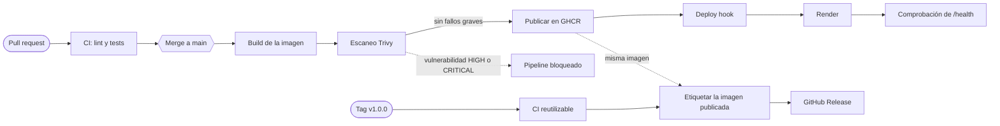
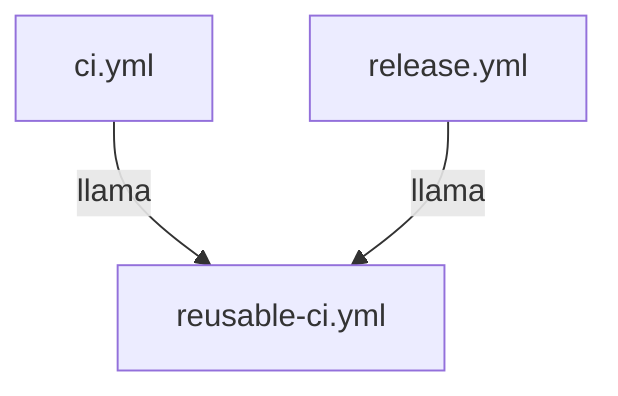

# github-actions-pipeline


Pipeline CI/CD completo con **GitHub Actions** para una API Node.js (Express): lint, tests en matriz, build de Docker, escaneo de vulnerabilidades con Trivy, publicación en GHCR, release automática y despliegue en Render.

**API en producción:** [Link](https://github-pipeline-api.onrender.com/health)

## Arquitectura del pipeline



La release **no reconstruye** la imagen: añade la etiqueta de versión a la que ya pasó el escaneo en `main`.

## Workflows

| Fichero | Se ejecuta | Qué hace |
|---|---|---|
| `reusable-ci.yml` | Lo llaman otros workflows | Lint y tests (matriz Node 22 y 24). Se define una vez |
| `ci.yml` | PR y push a `main` | Llama al reutilizable y expone el check `Resultado del CI` |
| `docker.yml` | PR y push a `main` | Build y escaneo Trivy. En `main`, además publica en GHCR y despliega en Render |
| `release.yml` | Al subir una etiqueta `v*.*.*` | Valida con el reutilizable, etiqueta la imagen y crea la release |



### Puertas de calidad

- **CI:** si falla el lint o algún test, no se puede fusionar el PR.
- **Trivy:** si encuentra vulnerabilidades HIGH o CRITICAL con parche disponible, no se publica la imagen ni se despliega.
- **Despliegue:** solo ocurre desde `main`, y tras publicar. Después se comprueba que `/health` responde.

### Detalles de diseño

- Permisos mínimos por job (`packages: write` solo al publicar, `contents: write` solo al crear la release).
- Caché de npm y de capas de Docker para acelerar las ejecuciones.
- Imagen de producción en dos etapas, sin npm ni dependencias de desarrollo.
- Contenedor ejecutado como usuario sin privilegios, con `HEALTHCHECK`.
- `main` protegida: todo cambio entra mediante pull request.

## La API

| Método | Ruta | Descripción |
|--------|------|-------------|
| GET | `/health` | Healthcheck, devuelve `{"status":"ok"}` |

## Desarrollo local

Requisitos: Node.js 22 o superior.

```bash
npm ci
npm run dev      # recarga automática
npm start        # arranque normal
curl http://localhost:3000/health
```

`PORT` y `HOST` se pueden cambiar con variables de entorno.

| Script | Descripción |
|--------|-------------|
| `npm run lint` | ESLint |
| `npm test` | Tests rápidos con Jest |
| `npm run test:ci` | Tests en modo CI con cobertura |

## Docker

Imagen publicada en GitHub Container Registry:

```bash
docker run -d --name api -p 3000:3000 ghcr.io/victorpinero21/github-actions-pipeline:latest
curl http://localhost:3000/health
```

Etiquetas disponibles: `latest` (última de `main`), `sha-xxxxxxx` (commit exacto) y `1.0.0` (versiones publicadas). Para algo reproducible, usa una versión o el `sha`, no `latest`.

## Configuración necesaria

Para reproducir el despliegue en otro repositorio:

| Qué | Dónde | Nombre |
|---|---|---|
| Secreto | Settings → Secrets and variables → Actions | `RENDER_DEPLOY_HOOK_URL` |
| Variable | Settings → Secrets and variables → Actions | `APP_URL` |
| Environment | Settings → Environments | `production` |

El servicio de Render se crea desde una imagen existente (`ghcr.io/<usuario>/<repo>:latest`) con el health check en `/health`.

## Publicar una versión

```bash
git switch main
git pull
git tag v1.0.0
git push origin v1.0.0
```

Antes de etiquetar, espera a que el workflow **Docker** termine en `main`, porque la release reutiliza la imagen ya publicada.

## Flujo de trabajo

```bash
git switch -c feature/mi-cambio
# cambios y commits
git push -u origin feature/mi-cambio
# abrir PR, esperar al CI y fusionar con squash
```

## Estructura

```
.github/workflows/   ci, reusable-ci, docker, release
src/                 app.js y server.js
tests/               tests con Jest y Supertest
Dockerfile           build en dos etapas
```

## Licencia

[MIT](LICENSE)
