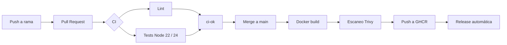

# github-actions-pipeline


Pipeline CI/CD completo con **GitHub Actions** para una API Node.js (Express): lint, tests, build de Docker, escaneo de vulnerabilidades, publicación en GHCR y release automática.

## Arquitectura del pipeline



> Los pasos desde *Docker build* en adelante están en desarrollo (ver estado).

## Estado del proyecto

- [x] Repositorio y README
- [x] API Express y tests
- [x] Workflow de CI (lint, tests, matriz, caché)
- [ ] Docker build, escaneo con Trivy y push a GHCR
- [ ] Workflow reutilizable y workflow de release
- [ ] Despliegue automático desde `main`
- [ ] README final y diagrama definitivo

## La API

| Método | Ruta | Descripción |
|--------|------|-------------|
| GET | `/health` | Healthcheck, devuelve `{"status":"ok"}` |

## Requisitos

- Node.js 22 o superior
- npm

## Desarrollo local

```bash
npm ci
npm run dev      # arranque con recarga automática
npm start        # arranque normal
```

La API escucha por defecto en `http://localhost:3000`. Se puede cambiar con las variables de entorno `PORT` y `HOST`.

```bash
curl http://localhost:3000/health
```

## Scripts

| Script | Descripción |
|--------|-------------|
| `npm start` | Arranca el servidor |
| `npm run dev` | Arranca con `node --watch` |
| `npm run lint` | Ejecuta ESLint |
| `npm test` | Tests rápidos con Jest |
| `npm run test:ci` | Tests en modo CI con cobertura |

## CI

El workflow `.github/workflows/ci.yml` se ejecuta en cada push a `main` y en cada pull request:

- **lint:** ESLint sobre todo el proyecto.
- **test:** Jest con cobertura en una matriz de Node 22 y 24.
- **ci-ok:** check agregador, el único que hay que exigir en las reglas de la rama.
- Caché de npm, cancelación de ejecuciones obsoletas en PRs y permisos mínimos (`contents: read`).

## Flujo de trabajo

`main` está protegida: todo cambio entra mediante pull request con el CI en verde.

```bash
git switch -c feature/mi-cambio
# ...cambios y commits...
git push -u origin feature/mi-cambio
# abrir PR en GitHub, esperar CI y fusionar
```

## Licencia

[MIT](LICENSE)
